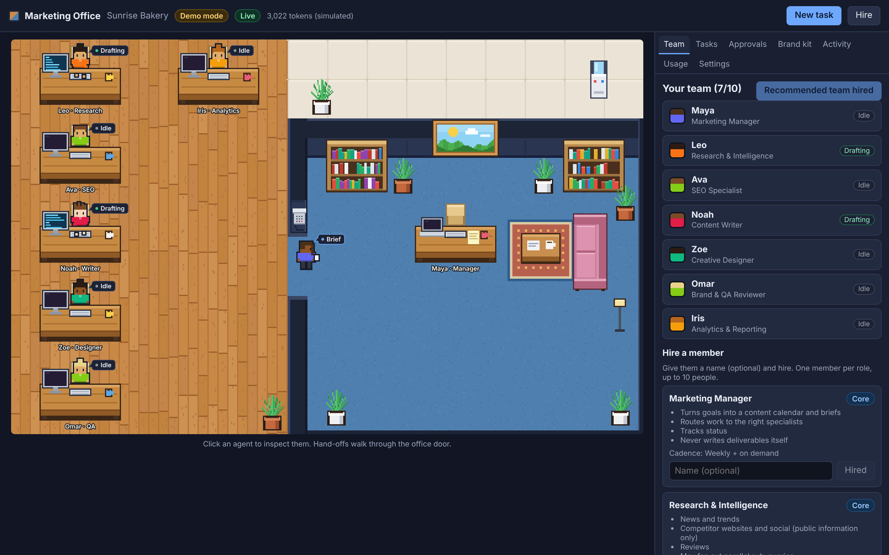

# PointO AI Marketing Team

AI marketing agents that work in a pixel-art office. You hire team members (Marketing Manager, Research,
SEO, Writer, Designer, Brand & QA Reviewer, Analytics, plus optional Paid Ads, Email/CRM and Community),
set your brand kit, and assign tasks either to the Manager (who plans and routes the work) or to a specific
member. You can watch agents work at their desks, hand work to each other, and wait for your approval.
Nothing is ever published automatically: every deliverable stops at **Approvals**, where you can edit,
approve, reject with feedback (the team revises), or export it as Markdown/JSON.

The whole app (backend + frontend) is one file: `server.js`.



More screenshots: [approval queue](docs/screenshots/approvals.png), [needs approval](docs/screenshots/needs-approval.png),
[hand-off](docs/screenshots/office-handoff.png), [800 px wide layout](docs/screenshots/narrow-800.png).

## Agent roster

| Agent | What it does |
|---|---|
| Marketing Manager | Turns a task into a brief and routes it to specialists. Never writes deliverables itself. |
| Research & Intelligence | News, trends, competitor websites and social (public information only); daily digest. Uses web search in live mode. |
| SEO Specialist | Keywords, content gaps, meta titles and descriptions, on-page recommendations. |
| Content Writer | Blogs, web and email copy, ad copy and every social platform (per-platform skills). |
| Creative Designer | Visual concepts, image prompts, carousel layouts, video scripts. |
| Brand & QA Reviewer | Scores each output against a rubric (`{pass, score, issues, suggestions}`); at most 2 revisions. |
| Analytics & Reporting | Performance reports; its learnings are fed into future briefs. |
| Optional | Paid Ads Specialist, Email/CRM Specialist, Community Manager. |

"Hire recommended team" adds the 7 core roles in one click. You can also hire roles one at a time with a
custom name and remove them. If a needed role is missing (for example no QA reviewer) the task still runs
and shows a warning.

## Workflow

```
queued -> briefing (Manager) -> in_progress (specialists) -> checks (deterministic)
       -> qa_review (QA agent) -> revision (max 2) -> awaiting_approval (you)
       -> approved | rejected with feedback (-> revision)
```

Assign a task to a specific member or choose "Let the Manager decide". Hand-offs are shown in the office:
the sprite walks to the next agent's desk. You can cancel a running task and retry a failed one.

## Quick start

```bash
npm install                          # once; the only dependency is @anthropic-ai/sdk
ANTHROPIC_API_KEY=sk-... npm start   # live mode, real Claude calls
MOCK=1 npm start                     # demo mode, no API key needed (same as npm run start:mock)
```

Without `ANTHROPIC_API_KEY` the app also starts in demo mode, and the header shows a "Demo mode" badge.

Open http://127.0.0.1:3000. Requires Node 22+.

## Environment variables

| Variable | Default | Meaning |
|---|---|---|
| `ANTHROPIC_API_KEY` | none | Claude API key. Without it (or with `MOCK=1`) the app runs in demo mode. |
| `MOCK` | unset | `1` forces demo mode: agents produce simulated, deterministic output; token counts are estimates labelled "simulated". |
| `PORT` / `HOST` | `3000` / `127.0.0.1` | Listen address. |
| `ALLOWED_HOSTS` | none | Extra comma-separated host names the app may be opened under (besides `localhost`, IP addresses and `HOST`). Requests with any other `Host` header get 421 (DNS-rebinding protection); state-changing requests from another web origin get 403. |
| `DATA_DIR` | `./data` | Where `state.json` is stored (atomic writes). |
| `MODEL` | `claude-opus-5-5` | Model for all agents. |
| `WORKER_MODEL` | same as `MODEL` | Optional cheaper model for Research and Analytics. |
| `MOCK_DELAY_MS` | `1200` | Simulated call duration in demo mode. |
| `HANDOFF_MS` | `1500` | Pause between pipeline steps so hand-off walks are visible. |
| `DIGEST_INTERVAL_MS` / `DIGEST_CHECK_MS` | 24 h / 60 s | Daily news digest schedule (enable in Settings; needs a Research member). |

## How it works

- **Pipeline per task:** brief (Manager, or a default plan) -> work steps by the routed members ->
  deterministic checks (platform length/hashtag limits, banned words, URLs, empty items) -> QA review ->
  up to 2 automatic revision rounds -> **awaiting approval**. Rejecting with feedback runs another
  revision. Tasks run concurrently up to the Settings limit (1-5); the rest queue.
- **Claude API:** `thinking: {type: "adaptive"}`, `max_tokens: 16000`, structured JSON output, the Research
  agent uses the `web_search_20260209` server tool; `pause_turn`, refusals, truncation and API errors are
  handled and shown on the task.
- **Live updates:** the browser gets a snapshot plus Server-Sent Events (`/api/events`) and reconnects with
  backoff.
- **Persistence:** state survives restarts; tasks that were running when the server stopped resume from the
  start of their pipeline. A corrupt `state.json` is set aside as `state.corrupt-<time>.json`.
- **Safety:** binds to localhost, 1 MB body limit, strict input validation, CSP headers, all model/user text
  rendered as text (no `innerHTML`). The API key never leaves the server.

## Safety notes

- **Human approval is mandatory.** Every deliverable stops in the Approvals queue. You approve, edit then
  approve, or reject with feedback.
- **No auto-publishing.** The app has no connection to any social network, email service or CMS. Approved
  content is copied or exported (Markdown/JSON), and you publish it yourself.
- **Competitor monitoring uses public information only**: public websites and web search. There is no
  logged-in scraping and no use of fake accounts.
- All model output is treated as untrusted and shown as plain text. The API key stays on the server.
- Bind to `127.0.0.1` (the default) unless you put the app behind your own authentication.

## Tests

All tests run in demo mode on random ports with temp data dirs; no API key is needed. Live-mode request
handling is covered by fake-client tests (real API calls are not exercised here).

```bash
node tests/lifecycle.test.mjs                 # black-box: spawns server.js, every endpoint, full lifecycle, restarts
MOCK_DELAY_MS=5 node tests/agents/test.mjs    # agents: catalog, routes, prompts, live engine via fake client, mock engine
node tests/agents/fuzz.mjs                    # mock engine fuzz vs. runChecks
node tests/backend/checks.test.mjs            # runChecks unit cases
node tests/backend/http.test.mjs              # HTTP robustness + persistence
node tests/backend/real.test.mjs              # pipeline with the real mock engine
node tests/backend/pipeline.test.mjs          # state machine edge cases with deterministic fake agents
node tests/backend/race.test.mjs              # cancel/retry race
node tests/frontend/e2e.cjs                   # Playwright UI flow (screenshots go to $SHOTS or $TMPDIR/pointo-shots)
node tests/frontend/fixture.cjs               # UI against a scripted snapshot (all statuses, XSS, links)
node tests/frontend/backoff.cjs               # SSE reconnect backoff, DPR scaling
node tests/frontend/smoke.cjs                 # quick load + screenshot
node tests/qa-agents-claude.test.mjs          # QA: Claude request rules, stop reasons, errors (fake client)
node tests/qa-api-backend.test.mjs            # QA: API contract, hostile traffic, crash recovery
node tests/qa-frontend-e2e.cjs                # QA: Playwright end-to-end, XSS, layouts
```

## Limits

- Agents draft content only; nothing is posted to social networks, sent by email or published anywhere.
- Designer output is visual concepts and prompts, not image files.
- Single user, single process, local JSON storage; not meant to be exposed to the internet as is.
